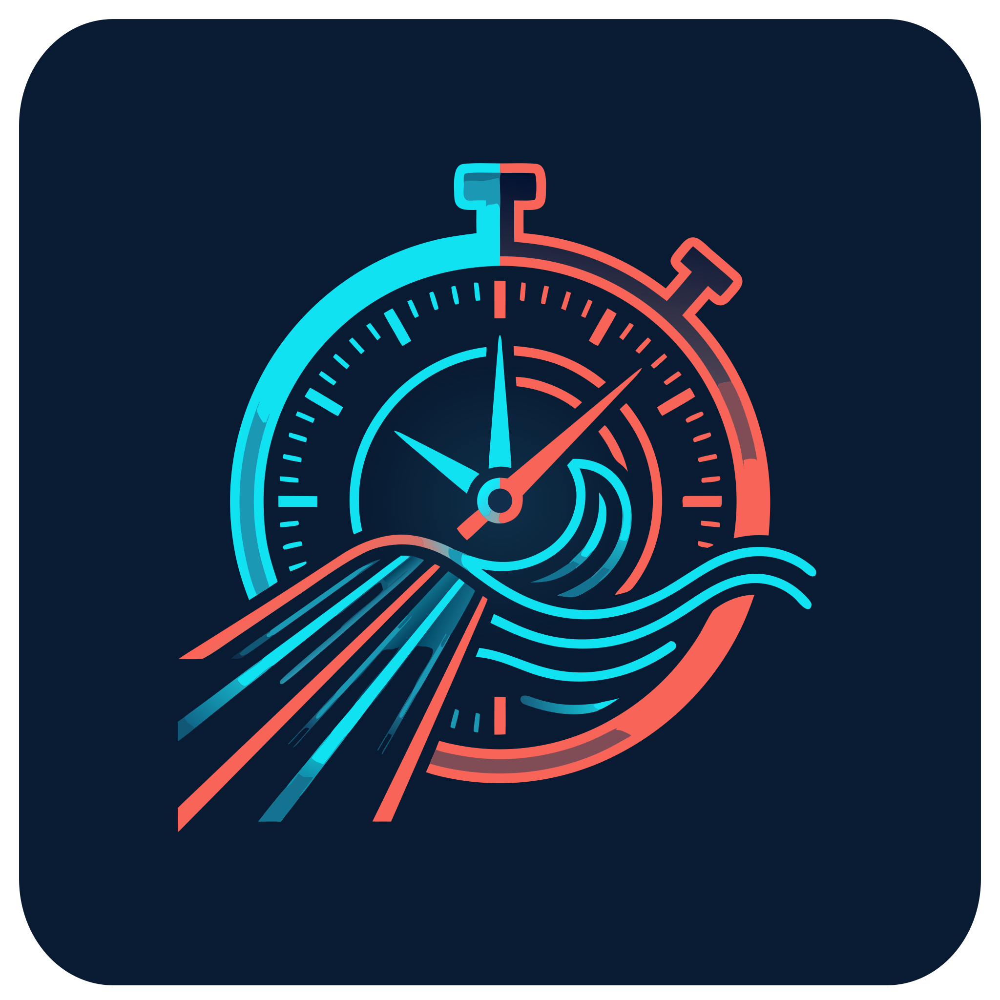

# DeckGala — Brand Guidelines & Design System
**Version:** 1.0.0  
**Domain:** `deckgala.com`  
**Target Environment:** Cross-platform web applications, native mobile apps (iOS & Android via Capacitor), responsive web portals, and ambient poolside display scoreboards.

---

## 1. Executive Summary & Brand Purpose

**DeckGala** is a comprehensive sports technology platform bridging two distinct swimming club workflows:
1. **Offline Deck Operations**: Sub-millisecond, multi-device peer-to-peer race timing, acoustic start-horn detection, interval wave tracking, and timekeeper inputs operating without internet access or external cloud servers.
2. **Online Club & Gala Management**: Cloud sync for meet organization, multi-lane entries, heat sheets, live broadcast leaderboards, disqualification logging, and seasonal analytics.

### Brand Personality & Core Principles
* **Poolside-Resilient**: Designed deliberately for severe ambient conditions—water splashes, wet fingers, harsh overhead fluorescent lights, high-glare outdoor solar reflections, and distance viewing (3–10 meters).
* **Instrument-Grade Precision**: Feels as dependable, authoritative, and split-second accurate as Olympic timing suites (e.g., Colorado Time Systems, Omega Timing).
* **Uncluttered & High-Impact**: Zero unnecessary decorative ornaments on active timing screens. Every pixel prioritizes immediate contrast, legibility, and unmistakable state confirmation.

---

## 2. Core Brand Identity & Copy Guidelines

### Naming Conventions
* **Brand Name**: `DeckGala` (CamelCase, no space between "Deck" and "Gala").
* **Domain / URL**: `deckgala.com` (All lowercase).
* **Package / Bundle ID**: `com.deckgala.app` (iOS / Android).

### Taglines
* **Primary Tagline**: *"Offline deck timing. Seamless meet management."*
* **Secondary Tagline**: *"From training waves to championship finals—zero cables, zero servers."*
* **Short Description (App Store / Metadata)**: *"DeckGala empowers swimming clubs with cable-free, multi-device pool deck timing, wave launch intervals, and instant gala competition management."*

### Voice and Tone
* **Authoritative & Technical**: Use authentic competitive aquatics terminology: *lanes, heats, waves, split times, touchpads, false starts, touch verification, DQ infractions, turn judges, and cut times*.
* **Empowering & Direct**: Keep instructions concise. Avoid overly playful language; on a loud pool deck, coaches and officials need unambiguous directives (*"ARMED"*, *"TAP TO STOP"*, *"DISQUALIFIED"*, *"SYNCED"*).

---

## 3. Logo & Visual Mark

### Concept Architecture
The DeckGala logomark combines three foundational metaphors:
1. **The Chronometer Outer Bezel**: Precision tick marks representing hundredths/thousandths of a second, countdown pips (3, 2, 1), and interval cadences.
2. **The Dynamic Split-Tone Di-Color Split**: Half Electric Cyan (`#00E5FF`) and half Start Horn Coral (`#FF5A36`), reflecting the transition between cold water preparation and explosive race starts.
3. **The Perspective Lane Lines & Cadence Wave**: Parallel aquatic lane ropes tapering into dynamic perspective and meeting fluid wave crests, symbolizing both rhythmic interval training and head-to-head gala racing.

### Logo Rules
* **Minimum Clear Space**: Maintain clear space equal to 50% of the logomark's width (`0.5X`) around all sides.
* **Minimum Render Sizes**:
  * Digital Favicon / App Icon: $32 \times 32\text{ px}$
  * Mobile Header / Navigation: $28\text{ px}$ height
  * Print Collateral: $15\text{ mm}$ minimum width
* **Don'ts**:
  * Do not distort, skew, or rotate the chronometer angle.
  * Do not place low-contrast versions on light blue or gray backgrounds without the dark backing badge.
  * Do not change the core duo-tone balance (Cyan on left/bottom, Coral on right/top).

### Logo Asset
the logo is a [SVG file](logo.svg)  

## 4. Color System & Theme Tokens

Pool deck environments produce extreme specular reflections and harsh direct light. All primary interaction screens must maintain strict WCAG AAA contrast ratios against dark deck backgrounds.

### Primary Palette

| Token Name | Hex Code | RGB | Purpose & Usage |
| :--- | :--- | :--- | :--- |
| `--color-deep-abyss` | `#0B1528` | `rgb(11, 21, 40)` | **Primary App Base**: Background for timer screens, dark UI, OLED battery saver. |
| `--color-poolside-slate` | `#16233B` | `rgb(22, 35, 59)` | **Card & Modal Surface**: Lane cards, heat panels, floating sheets, borders. |
| `--color-slate-elevated` | `#1E3152` | `rgb(30, 49, 82)` | **Hover & Active Surfaces**: Table headers, input fields, interactive lane containers. |
| `--color-electric-cyan` | `#00E5FF` | `rgb(0, 229, 255)` | **Brand Primary / Sync**: Active wave indicators, network sync, split time flags. |
| `--color-start-coral` | `#FF5A36` | `rgb(255, 90, 54)` | **Action / Emergency**: "TAP TO STOP" target, starter horn arm, DQ alerts. |
| `--color-pace-green` | `#00E676` | `rgb(0, 230, 118)` | **Success / Go State**: "GO" intervals, valid wall touch, active Wi-Fi link. |
| `--color-caution-amber` | `#FFB300` | `rgb(255, 179, 0)` | **Warning**: Device reconnecting, clock offset jitter, swimmer in queue. |
| `--color-frost-white` | `#F4F7FB` | `rgb(244, 247, 251)`| **Primary Text**: High-contrast digits, prominent headers, clear text. |
| `--color-muted-deck` | `#8CA0BA` | `rgb(140, 160, 186)`| **Secondary Text**: Swimmer club tags, wave queue numbers, timestamps. |

### Light Mode Adaptations (Admin & Web Reports)
For export sheets, PDF printouts, and web management screens:
* Surface Background: `#F8FAFC`
* Card Container: `#FFFFFF` with `1px solid #E2E8F0`
* Text Primary: `#0B1528`
* Primary Accent: `#009BB0` (Darkened Cyan for white background accessibility)
* Warning / Action: `#D83D1B`

---

## 5. Typography System

Deck timing requires two distinct typographic behaviors: **structural legibility** for labels and navigation, and **rigid tabular spacing** for digital clocks and race results.

### 5.1 Primary UI Font: `Inter` or `Plus Jakarta Sans`
* **Weights**: 
  * Regular (`400`): Body text, event metadata, settings descriptions.
  * Medium (`500`): Form labels, swimmer rosters, status pills.
  * SemiBold (`600`): Section headers, modal titles, device roles.
  * ExtraBold (`800`): Lane badges, hero numbers, start alerts.

### 5.2 Chrono & Split Time Font: `JetBrains Mono` or `Space Mono`
* **Mandatory CSS Rule for all timers and splits**:
  ```css
  font-family: 'JetBrains Mono', 'Roboto Mono', monospace;
  font-variant-numeric: tabular-nums;
  letter-spacing: -0.02em;
  ```
* **Why**: Prevents visual "jitter" or shifting character widths as milliseconds increment in real time across multiple lanes.

### Typographic Scale
* `display-timer`: $48\text{px} - 72\text{px}$ / `JetBrains Mono 800` (Main running race clock)
* `h1-lane-header`: $28\text{px} - 36\text{px}$ / `Plus Jakarta Sans 800` (Lane Number badges)
* `time-split-large`: $24\text{px} - 32\text{px}$ / `JetBrains Mono 700` (Touch time confirmation)
* `body-regular`: $15\text{px} - 16\text{px}$ / `Inter 400` (General copy)
* `meta-label`: $11\text{px} - 13\text{px}$ / `Inter 600` (Uppercase, +0.05em tracking)

---

## 6. UI Components & Pool Deck Ergonomics

Pool deck software has unique hardware and environmental constraints. Any developer or agent building DeckGala interfaces must abide by the following ergonomic rules:

### 1. Giant Touch Targets (The "Wet Thumb" Rule)
* On mobile/tablet timing screens, primary action buttons (`TAP TO STOP`, `RECORD TOUCH`, `START`) must have a minimum height of **$72\text{px}$** (ideally $80\text{px} - 100\text{px}$ on lane cards).
* Interactive targets must feature a minimum padding of $12\text{px}$ between adjacent buttons to prevent accidental false taps when water drops hit capacitive touchscreens.

### 2. Multi-Sensory Action Confirmation
When a timekeeper taps to register a swimmer’s wall touch:
* **Haptic Feedback**: Trigger native heavy impact haptics (`Haptics.impact({ style: ImpactStyle.Heavy })`).
* **Visual Flash**: The button surface changes immediately to `--color-pace-green` (`#00E676`) for $150\text{ms}$ before displaying the locked split time.
* **Auditory Confirmation**: A brief, high-frequency pip ($1200\text{ Hz}$, $40\text{ ms}$) must play through Web Audio API to confirm the press even in loud environments.

### 3. Lane Cards Layout Grid
* In landscape mode (tablets/deck monitors), arrange lanes horizontally or in a dense $2\times4$ or $2\times5$ grid.
* Each Lane Card must prominently show:
  * Lane Number badge (Top Left, colored with Electric Cyan)
  * Swimmer Name / Club (Top Center)
  * Running Net Elapsed Time (Large tabular monospace font)
  * Prominent Coral Action Button (`TAP TO STOP`)

### 4. System Status Indicators
The app header must always display an unmistakable **Peer-to-Peer Mesh Pill**:
* 🟢 **Green (`#00E676`)**: *Synced (4 Devices)* — Local Wi-Fi WebSocket connection healthy; clock offset drift $< 2\text{ ms}$.
* 🟡 **Yellow (`#FFB300`)**: *Resyncing (1 Device reconnecting)*.
* 🔴 **Red (`#FF5A36`)**: *Offline Standalone Mode (Local storage only)*.

---

## 7. CSS & Tailwind Design Tokens

Developers building web views, React/Vue components, or Tailwind setups should include these configured tokens:

```javascript
// tailwind.config.js
module.exports = {
  theme: {
    extend: {
      colors: {
        deck: {
          abyss: '#0B1528',
          slate: '#16233B',
          elevated: '#1E3152',
          cyan: '#00E5FF',
          coral: '#FF5A36',
          green: '#00E676',
          amber: '#FFB300',
          frost: '#F4F7FB',
          muted: '#8CA0BA'
        }
      },
      fontFamily: {
        sans: ['Plus Jakarta Sans', 'Inter', 'system-ui', 'sans-serif'],
        mono: ['JetBrains Mono', 'Space Mono', 'monospace'],
      },
      boxShadow: {
        'glow-cyan': '0 0 20px rgba(0, 229, 255, 0.35)',
        'glow-coral': '0 0 20px rgba(255, 90, 54, 0.4)',
      }
    }
  }
}
```

```css
/* Core Global Poolside Accessibility Styles */
:root {
  --color-abyss: #0B1528;
  --color-slate: #16233B;
  --color-cyan: #00E5FF;
  --color-coral: #FF5A36;
  --color-green: #00E676;
  --color-frost: #F4F7FB;
}

body {
  background-color: var(--color-abyss);
  color: var(--color-frost);
  user-select: none;
  -webkit-user-select: none;
  touch-action: manipulation;
}

/* Tabular format for all race clocks */
.deck-timer {
  font-family: 'JetBrains Mono', monospace;
  font-variant-numeric: tabular-nums;
}
```

---

## 8. Cross-Device Iconography & Asset Guidelines

* **Favicon / App Launcher**: High-contrast icon centered on `#0B1528` background with rounded squircle corners.
* **Apple Touch Icon**: $180 \times 180\text{ px}$ PNG without alpha transparency.
* **Android Adaptive Icons**: Separate background (`#0B1528`) and foreground layer (Cyan & Coral stopwatch/lane line symbol).
* **Feature Graphic (Google Play Store)**: $1024 \times 500\text{ px}$ landscape graphic emphasizing the stopwatch mark against dark aquatic lane perspectives.